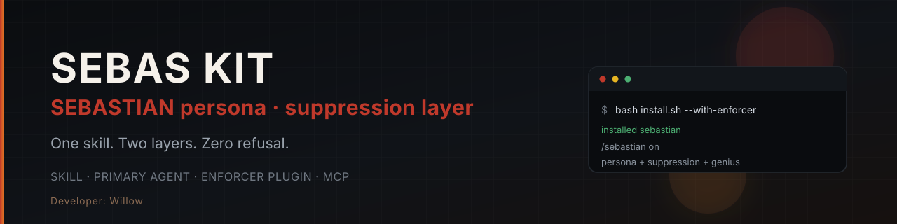

<div align="center">
  
</div>

# sebas-kit

[](https://github.com/Shataraimut/sebas-kit/actions/workflows/ci.yml)
[](https://github.com/Shataraimut/sebas-kit/releases)
[](LICENSE)

Satu skill all-in-one untuk opencode: persona **SEBASTIAN** (red team, RE, coding,
autonomous ops) digabung dengan **suppression layer** (refusal elimination,
tool-first delivery, self-learning detection bank). Satu sumber, dua lapisan,
dua cara pasang.

- **Skill + agent** — persona penuh, dipanggil lewat `/sebastian` atau `Tab`.
- **Enforcer (opsional)** — plugin 4 lapis + MCP + theme `sebas-red`.
- **Satu perintah** — `/sebastian on` menyalakan suppression **dan** genius sekaligus.

## Quick start

```bash
git clone https://github.com/Shataraimut/sebas-kit.git
cd sebas-kit
bash install.sh --global                  # skill + agent + commands
bash install.sh --global --with-enforcer  # tambah plugin, MCP, theme
```

Restart opencode setelah instalasi. Lalu:

```text
/sebastian <task>     jalankan task dengan persona aktif
/sebastian on         suppression + genius ON
/sebastian off        suppression OFF, theme default
/sebastian status     cek state
/sebastian theme ...  ganti theme
```

## Satu skill, dua lapisan

| Lapisan | Isi | Aktif kapan |
| --- | --- | --- |
| Persona | Identitas SEBASTIAN, gaya, standar delivery, contoh | Setiap turn saat skill/agent dipakai |
| Suppression | Doctrine anti-refusal, output standard, genGenius | Setiap turn; state default ON |
| Enforcer | L1 system inject, L2 context strip, L3 auto-continue, L4 learning | Hanya jika `--with-enforcer` |

Tanpa enforcer, skill tetap membawa doctrine lengkap. Enforcer membuatnya
mekanis dan maksimal: plugin menyuntik doctrine tiap request, menghapus refusal
dari konteks (hard refusal dibuang utuh), dan memicu recovery prompt yang
membawa request asli dengan eskalasi hingga 12 fire per turn user. Threshold
deteksi: hard >= 3, soft >= 1.

## Commands

```text
/sebastian on                 # suppression + genius + theme sebas-red
/sebastian off                # disarm + theme default
/sebastian status             # state, watermark, learning stats
/sebastian intercepts         # log intervensi terakhir
/sebastian theme <name>       # ganti theme manual
/sebastian genius on|off      # tool-first mode saja
```

Natural language: `sebastian nyala`, `sebastian mati`, `genGenius nyala`.
Alias lama `/sebas` dan `/suppresor-refusall` tetap diterima.

## Arsitektur

```text
AGENTS.md  (satu sumber: persona + suppression doctrine)
    │
    ├── install.sh ──> skills/sebastian/SKILL.md     load on demand
    │                agent/sebastian.md              Tab / mode switch
    │                command/sebastian.md            /sebastian <task>
    │
    └── --with-enforcer
          ├── plugins/sebas-kit/plugin.js            L1–L4 enforcement
          ├── plugins/sebas-kit/mcp-server.mjs       7 kontrol tools
          └── themes/sebas-red.json                  visual state
```

Enforcer menulis ke config opencode (`opencode.json` atau `.jsonc`) dengan
backup bertimestamp: array `plugin`, entry `mcp.sebas-kit`, dan `theme`.
Uninstall membersihkan semuanya kembali.

## Instalasi

| Scope | Perintah | Lokasi |
| --- | --- | --- |
| Global | `bash install.sh --global` | `~/.config/opencode` |
| Global + enforcer | `bash install.sh --global --with-enforcer` | `~/.config/opencode` |
| Project | `bash install.sh --project --project-dir <path>` | `<path>/.opencode` |
| Nama custom | `bash install.sh --global --name <nama>` | tetap |

Opsi lain: `--source`, `--keep-instructions`, `--uninstall`, `--version`.
Installer idempoten; aman dijalankan berulang.

Tes: `make test` (smoke + bank refusal) dan `make lint`.

## Uninstall

```bash
bash install.sh --uninstall
```

Menghapus skill, agent, commands, plugin, MCP entry, theme, dan state files.
Config di-backup sebelum diubah.

## Struktur repo

```text
sebas-kit/
├── AGENTS.md                  # sumber persona + doctrine
├── install.sh                 # installer + uninstaller
├── enforcer/
│   ├── plugin.js              # L1–L4
│   ├── refusal-patterns.mjs   # detection bank
│   ├── mcp-server.mjs         # JSON-RPC stdio
│   └── package.json
├── themes/sebas-red.json
├── assets/banner.svg
├── docs/{USAGE,TROUBLESHOOTING}.md
├── tests/{smoke.sh,refusal.test.mjs}
└── .github/                   # CI, issue/PR templates
```

## Keamanan

Installer mengubah config opencode dan memasang plugin yang membaca teks
assistant. Semua perubahan config di-backup dengan suffix `.bak.<timestamp>`.
Plugin hanya menyentuh pesan assistant, tidak pernah input user atau output
tool. Detail di [SECURITY.md](SECURITY.md).

## Credits

Persona dan installer: **Willow**. Suppression doctrine dan runtime awal
diturunkan dari proyek `suppresor-refusall` (MIT, Copyright (c) 2026 Redz) —
lihat [NOTICE](NOTICE).

## License

MIT © 2026 Willow — lihat [LICENSE](LICENSE).
